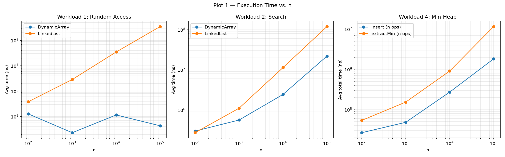
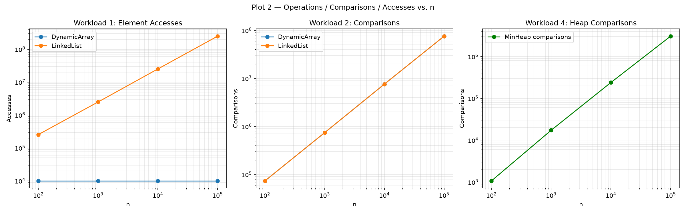

# Assignment 2 — Algorithmic Analysis, Correctness and Performance Trade-offs

## 1. Overview

This project implements and analyzes three data structures — a **Dynamic Array**, a **doubly-linked List**, and a binary **Min-Heap** — all written from scratch in Java. Each structure exposes the operations required by the assignment (`add`, `add(index,x)`, `remove(index)`, `get(index)`, `contains(x)` for Array/List; `insert`, `peekMin`, `extractMin` for the heap).

Beyond correctness, the goal of the assignment is to compare theoretical asymptotic complexity against measured performance across four controlled workloads, and to explain where the two agree and where implementation details (memory layout, constant factors) cause practical performance to diverge from the Big-O picture.

## 2. Complexity Analysis

| Data Structure | Operation | Best | Average | Worst | Aux. Space |
|---|---|---|---|---|---|
| Dynamic Array | `add(x)` | Θ(1) | Θ(1) amortized | O(n) (resize copy) | O(1), O(n) during resize |
| Dynamic Array | `add(index,x)` | Θ(1) (index = size) | Θ(n) | Θ(n) (index = 0) | O(1) |
| Dynamic Array | `remove(index)` | Θ(1) (index = size−1) | Θ(n) | Θ(n) (index = 0) | O(1) |
| Dynamic Array | `get(index)` | Θ(1) | Θ(1) | Θ(1) | O(1) |
| Dynamic Array | `contains(x)` | Ω(1) (found at index 0) | Θ(n) | O(n) (not found) | O(1) |
| Linked List | `add(x)` (tail ptr) | Θ(1) | Θ(1) | Θ(1) | O(1) |
| Linked List | `add(index,x)` | Θ(1) (index=0 or size) | Θ(n) | Θ(n) (index=size/2) | O(1) |
| Linked List | `remove(index)` | Θ(1) (index=0 or last) | Θ(n) | Θ(n) (index=size/2) | O(1) |
| Linked List | `get(index)` | Θ(1) (index=0 or size−1) | Θ(n) | Θ(n) (index=size/2) | O(1) |
| Linked List | `contains(x)` | Ω(1) | Θ(n) | O(n) | O(1) |
| Min-Heap | `insert(x)` | Θ(1) (no sift needed) | O(log n)* | Θ(log n) | O(1) |
| Min-Heap | `peekMin()` | Θ(1) | Θ(1) | Θ(1) | O(1) |
| Min-Heap | `extractMin()` | Θ(1) (heap empties or no sift needed) | Θ(log n) | Θ(log n) | O(1) |

\* Rigorous average-case analysis of random insertions into a heap actually gives an expected O(1) number of swaps (most new leaves don't bubble far), even though the worst case is Θ(log n).

**Justifications:**

- **DynamicArray `get`** is Θ(1) always — direct index into contiguous memory, no dependence on `n` or position.
- **DynamicArray `add(index,x)`/`remove(index)`** worst case is at `index=0`: every one of the `n` elements must shift by one slot. Best case is at the tail: zero shifts.
- **LinkedList `get`** looks similar to array's Θ(1) at the *ends* only because of the head/tail optimization in `getNode` — but for a *random* index it's Θ(n), unlike the array. This is the key practical difference: two structures can look similar for edge cases but diverge completely for the general case.
- **LinkedList `add(index,x)`/`remove(index)`** at the *ends* is Θ(1) because there's no shifting — only pointer relinking — regardless of `n`. This is the structural advantage a linked list has over an array.
- **contains()** is Θ(n) average/worst for both structures, but the constant factor differs sharply because array scanning is cache-friendly (contiguous memory) while list traversal is not (scattered nodes, pointer chasing).
- **Heap operations** are Θ(log n) because the tree height is ⌊log₂ n⌋, and both `siftUp`/`siftDown` do at most one step per level.

## 3. Correctness

### Invariant 1 — `DynamicArray.add(index, x)` (shift-right loop)

```java
for (int i = size; i > index; i--) {
    data[i] = data[i - 1];
}
data[index] = x;
```

Let `n` denote the value of `size` *before* this call, and let `A[0..n-1]` denote the array's contents at that moment.

**Loop Invariant.** At the start of each iteration, for the current value of `i`:
- every slot `k` with `i < k ≤ n` already holds the value originally at position `k−1` (i.e. `data[k] = A[k-1]`) — the part already shifted right;
- every slot `k` with `index ≤ k ≤ i` still holds its original value `A[k]` — the part not yet touched.

**Initialization.** Before the first iteration, `i = n`. The "already shifted" range (`i < k ≤ n`) is empty, so it holds vacuously. The "untouched" range (`index ≤ k ≤ n`) covers exactly the elements that haven't been written yet — true, since the loop hasn't run at all. Invariant holds.

**Maintenance.** Assume the invariant holds for the current `i > index`. The body executes `data[i] = data[i-1]`. By the invariant, slot `i-1` lies in the untouched range (since `index ≤ i-1 ≤ i`), so `data[i-1]` still equals `A[i-1]`. The assignment copies this value into slot `i`, which extends the "shifted" range downward by exactly one slot. No other slot changes. After `i` decrements, the two ranges (`shifted: k > i`, `untouched: index ≤ k ≤ i`) match this new reality exactly. Invariant preserved.

**Termination.** The loop exits when `i = index`. By the invariant at that point: every slot `k` with `index < k ≤ n` now equals `A[k-1]` (fully shifted), and the one remaining untouched slot is `k = index`, still holding `A[index]`.

**Correctness.** Immediately after the loop, `data[index] = x` overwrites that last untouched slot. The resulting array satisfies exactly the specification of insertion at `index`: positions `0..index-1` are unchanged (the loop never wrote there), position `index` holds the new element, and positions `index+1..n` hold, in order, what used to be `A[index..n-1]`. This proves `add(index, x)` correctly inserts `x` at the requested position. ∎

### Invariant 2 — `MinHeap.siftDown(index)` (used inside `extractMin`)

```java
while (true) {
    int left = 2 * index + 1;
    int right = 2 * index + 2;
    int smallest = index;
    if (left < size && compare(left, smallest) < 0) smallest = left;
    if (right < size && compare(right, smallest) < 0) smallest = right;
    if (smallest == index) break;
    swap(index, smallest);
    index = smallest;
}
```

Context: `extractMin()` removes the root, moves the *last* element into the root slot, then calls `siftDown(0)`. Everywhere in the array except the root now holds its original, untouched value from a heap that was fully valid before the removal.

**Loop Invariant.** At the start of every iteration:
1. Every node other than the current `index` satisfies the min-heap property with respect to its own children (parent ≤ each child) — the *only* place a violation can exist is between `index` and its children.
2. If `index` has a parent, that parent's value is ≤ the value currently stored at `index`.

**Initialization.** `index = 0` (the root). Clause 1: since only the root's value changed (replaced by the last element), and every other node still holds its pre-removal value from a heap that was fully valid, every non-root node still satisfies the property with its own children. Clause 2 is vacuous (the root has no parent). Invariant holds.

**Maintenance.** Assume the invariant holds for the current `index`, holding some value `P`. The loop computes `smallest` = the minimum among `{index, left, right}` (within bounds), using exactly one or two calls to `compare()`.

- If `smallest == index`: `P` is already ≤ both existing children, so clause 1 now holds for `index` too — combined with the invariant, the *entire* array satisfies the min-heap property. The loop breaks.
- Otherwise, `swap(index, smallest)` runs. Let `C` be the value that was at `smallest` (a child of `index`) before the swap; by construction `C ≤ P` and `C` ≤ the other child's value. After the swap, `index`'s old position now holds `C` and satisfies the property with respect to both its children (since `C` was the minimum of the three). The variable `index` moves to `smallest`, which now holds `P`. Its new parent (the old `index` position) now holds `C ≤ P` — clause 2 is preserved by construction, since `C` was chosen as the minimum of a set that included `P`.

**Termination.** The loop can only run for as many iterations as the height of the heap, `O(log n)` (`index` strictly moves one level deeper each time it doesn't break), so it always terminates — either by hitting `smallest == index`, or by falling out of bounds on both children (a leaf), which forces `smallest == index` on the next check.

**Correctness.** At termination, clause 1 holds for every node, with no exception left — meaning the whole array is a valid min-heap. Since `extractMin` returned the value that was at the root *before* this repair (saved before any swaps), and the heap invariant is restored afterward, `extractMin` is correct. ∎

## 4. Experimental Setup

- **n** (initial elements): 100, 1,000, 10,000, 100,000.
- **m** (operations per workload): 10,000 random accesses (Workload 1), 1,000 searches (Workload 2), 1,000 insertions/removals at each of two positions — start and middle (Workload 3), n inserts + n extracts (Workload 4).
- **Repetitions:** every timed measurement is run 5 times; the reported time is the arithmetic mean. Comparison/access/movement counts are not averaged because, given a fixed seed, they are deterministic across repetitions — only wall-clock time varies run to run (JIT warm-up, GC, OS scheduling).
- **Timing:** `System.nanoTime()`, measured strictly around the operation loop — input generation and structure population happen before the timer starts.
- **Random seed:** `new Random(42)`, re-seeded identically at the start of every repetition so that each repetition operates on the same generated data.
- **Edge case handled:** for Workload 3 at `n = 100`, 1,000 removals cannot be performed on a structure with only 100 elements — the removal loop stops once the structure is empty, so fewer than 1,000 removals are actually measured for that row (see Discussion).

## 5. Results

### Workload 1 — Random Access

| Structure | n | Avg time (ns) | Accesses | Theoretical |
|---|---|---|---|---|
| DynamicArray | 100 | 127,124.8 | 10,000 | Θ(1) |
| DynamicArray | 1,000 | 23,125.0 | 10,000 | Θ(1) |
| DynamicArray | 10,000 | 115,583.4 | 10,000 | Θ(1) |
| DynamicArray | 100,000 | 43,166.8 | 10,000 | Θ(1) |
| LinkedList | 100 | 383,008.4 | 255,745 | Θ(n) |
| LinkedList | 1,000 | 2,870,275.0 | 2,497,236 | Θ(n) |
| LinkedList | 10,000 | 34,896,124.8 | 25,125,556 | Θ(n) |
| LinkedList | 100,000 | 349,537,166.6 | 248,896,755 | Θ(n) |

### Workload 2 — Search

| Structure | n | Avg time (ns) | Comparisons | Theoretical |
|---|---|---|---|---|
| DynamicArray | 100 | 297,900.2 | 73,592 | Θ(n) |
| LinkedList | 100 | 271,599.8 | 73,592 | Θ(n) |
| DynamicArray | 1,000 | 560,916.4 | 742,593 | Θ(n) |
| LinkedList | 1,000 | 1,103,808.4 | 742,593 | Θ(n) |
| DynamicArray | 10,000 | 2,432,175.2 | 7,602,435 | Θ(n) |
| LinkedList | 10,000 | 11,339,958.4 | 7,602,435 | Θ(n) |
| DynamicArray | 100,000 | 21,958,700.2 | 75,711,685 | Θ(n) |
| LinkedList | 100,000 | 119,764,199.8 | 75,711,685 | Θ(n) |

### Workload 3 — Insertion and Removal (selected rows; full data in `results/tables/workload3_insert_remove.csv`)

| Structure | n | Operation | Position | Avg time (ns) | Movements |
|---|---|---|---|---|---|
| DynamicArray | 100,000 | insert | start | 48,648,308.4 | 100,500,500 |
| DynamicArray | 100,000 | insert | middle | 23,605,191.8 | 50,500,500 |
| LinkedList | 100,000 | insert | start | 5,341.8 | 1,000 |
| LinkedList | 100,000 | insert | middle | 68,962,941.6 | 50,000,999 |
| DynamicArray | 100,000 | remove | start | 40,247,158.4 | 99,499,500 |
| LinkedList | 100,000 | remove | start | 1,966.8 | 1,000 |

### Workload 4 — Priority Processing (Min-Heap)

| n | Avg insert time (ns) | Avg extractMin time (ns) | Comparisons | Order correct |
|---|---|---|---|---|
| 100 | 26,675.0 | 53,992.0 | 1,069 | true |
| 1,000 | 48,366.8 | 153,808.2 | 17,322 | true |
| 10,000 | 272,800.2 | 910,075.0 | 239,284 | true |
| 100,000 | 1,828,416.8 | 11,595,608.6 | 3,059,283 | true |

**Plot 1 — Execution Time vs. n:**



**Plot 2 — Operations/Comparisons/Accesses vs. n:**



## 6. Discussion

**1. How does increasing n affect each workload?**
Random Access and Search scale with n for LinkedList (linear growth in both time and comparisons/accesses), while DynamicArray access time stays flat regardless of n. Insertion/removal at the start scales linearly with n for DynamicArray (more elements to shift) but stays constant for LinkedList. Heap operations grow logarithmically per operation, so total time for n operations grows as n log n.

**2. Which experimental results agree with theoretical complexity?**
Almost everything except DynamicArray's raw timing on Workload 1. LinkedList's linear growth in accesses (Workload 1) and comparisons (Workload 2, matching DynamicArray's comparison counts exactly) both track Θ(n) precisely. Workload 3 movement counts for DynamicArray at `index=0` match the closed-form sum for shifting (verified by hand for n=100: predicted 600,500, measured 600,500). Heap comparison counts grow consistently with n log n.

**3. Where do the experimental results differ from theoretical prediction?**
DynamicArray's `get(index)` timing in Workload 1 does not grow monotonically with n (127μs at n=100, only 23μs at n=1,000, 115μs at n=10,000, 43μs at n=100,000) even though the operation is Θ(1) at every n. This isn't a correctness problem — the *access count* is a flat 10,000 at every n, exactly as expected. The noise comes from JIT compilation warm-up and OS scheduling: on an O(1) operation running for only microseconds total, timer resolution and JIT state dominate the measurement far more than the algorithm itself.

**4. Why can two algorithms with the same Big-O complexity have different running times?**
Workload 2 is the clearest example: DynamicArray and LinkedList perform the *exact same number of comparisons* at every n (e.g. 7,602,435 at n=10,000 for both), yet DynamicArray is roughly 4.7x faster (2.4ms vs 11.3ms). Both are Θ(n), but the array's elements are contiguous in memory (good cache locality, hardware prefetching), while the list's nodes are scattered on the heap (pointer chasing, frequent cache misses). Same Big-O, very different constant factor.

**5. How do constant factors and implementation details affect performance?**
Beyond cache locality (above), the doubly-linked list's `getNode` optimization (walking from whichever end is closer) reduces the *constant* in front of n (average n/4 steps instead of n/2) without changing the asymptotic class — it's still Θ(n) for a random index, just with a smaller multiplier, visible in the measured accesses-per-call ratio.

**6. Why is a Dynamic Array preferable for some workloads?**
For random access and search, DynamicArray wins decisively — Workload 1 shows LinkedList taking 349ms vs DynamicArray's ~43μs at n=100,000, a difference of roughly four orders of magnitude. Whenever the workload is read-heavy with arbitrary indices, or requires cache-friendly sequential scans, the array is the clear choice.

**7. When can a Linked List be useful?**
Workload 3 shows LinkedList insert/remove at the start staying at a constant ~1,000-5,000ns regardless of n (100 to 100,000), while DynamicArray's cost at the same position grows into tens of milliseconds at large n. Any workload dominated by insertions/removals at a known end (a queue, a stack, an undo history) favors the linked list.

**8. Why is a Heap appropriate for priority-based processing?**
Workload 4 confirms `extractMin` always returns elements in non-decreasing order (`orderCorrect = true` at every n) while keeping both `insert` and `extractMin` at Θ(log n) — far cheaper than keeping a fully sorted structure (which would need Θ(n) insertion) while still always giving O(1) access to the current minimum via `peekMin`.

**9. How does the workload influence the choice of data structure?**
The four workloads together show there's no universal winner: DynamicArray dominates read/search-heavy workloads (1, 2) and end-based insertion where amortized append is used; LinkedList dominates workloads dominated by insertion/removal at a known end (Workload 3, start position); MinHeap is the only structure that gives efficient repeated access to a running minimum (Workload 4). The right structure depends entirely on which operation the workload calls most often, not on a single "best" data structure.

## 7. Design Recommendations

- **Workload 1 (random access)** → Dynamic Array. O(1) direct indexing with no traversal cost.
- **Workload 2 (search)** → Dynamic Array, for cache-locality reasons, even though both structures share the same asymptotic class.
- **Workload 3, start-position insert/remove** → Linked List. O(1) regardless of size, versus O(n) shifting in an array.
- **Workload 3, middle-position insert/remove** → Neither is asymptotically better (both Θ(n)); Dynamic Array wins in practice due to cache locality even while shifting.
- **Workload 4 (priority processing)** → Min-Heap is the only structure suited to this workload; neither Array nor List can support O(log n) `extractMin`.

## 8. Conclusion

All three structures behave correctly (verified via `Tests.java` and the loop-invariant proofs above) and their measured performance matches theoretical complexity in almost every case — the one apparent mismatch (DynamicArray's non-monotonic timing in Workload 1) is explained by measurement noise on a sub-microsecond O(1) operation, not by an algorithmic issue, and is confirmed by the flat access count at every n. The experiments confirm that Big-O alone doesn't predict real-world performance: Workload 2 shows identical comparison counts but a 4-5x time gap between structures purely due to memory layout. Structure choice should be driven by the dominant operation of the actual workload, not by a single structure being "generally best."
